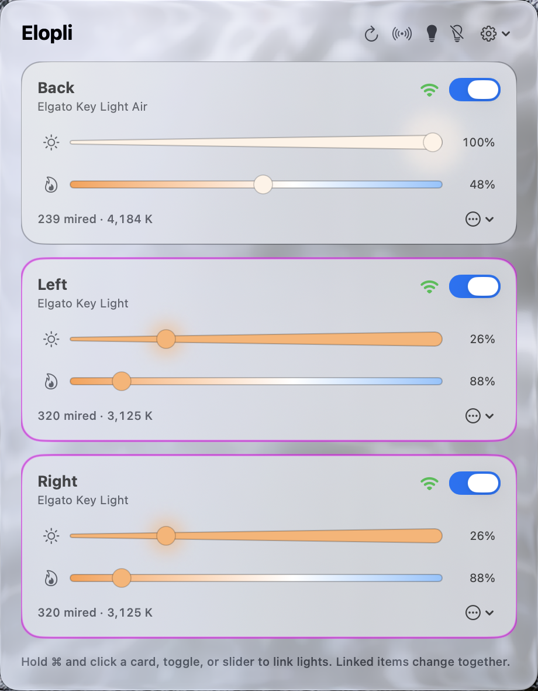
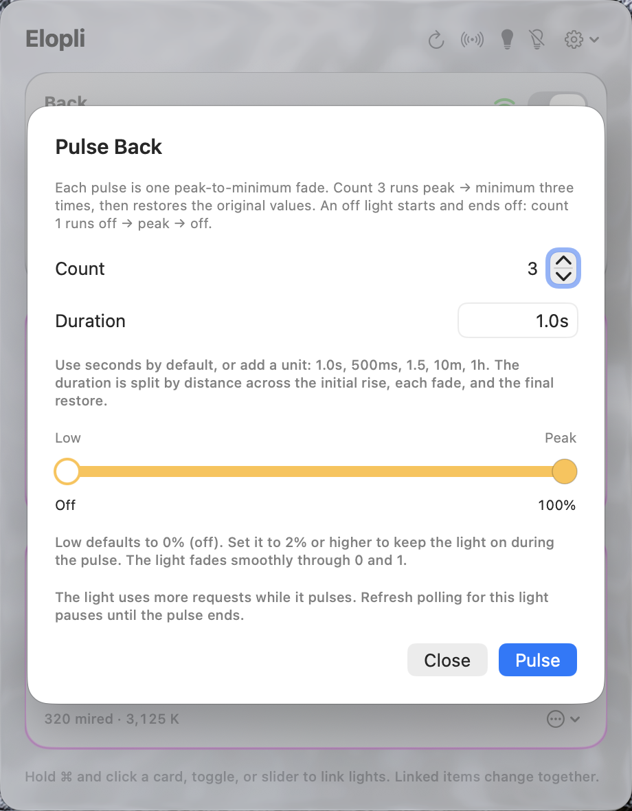
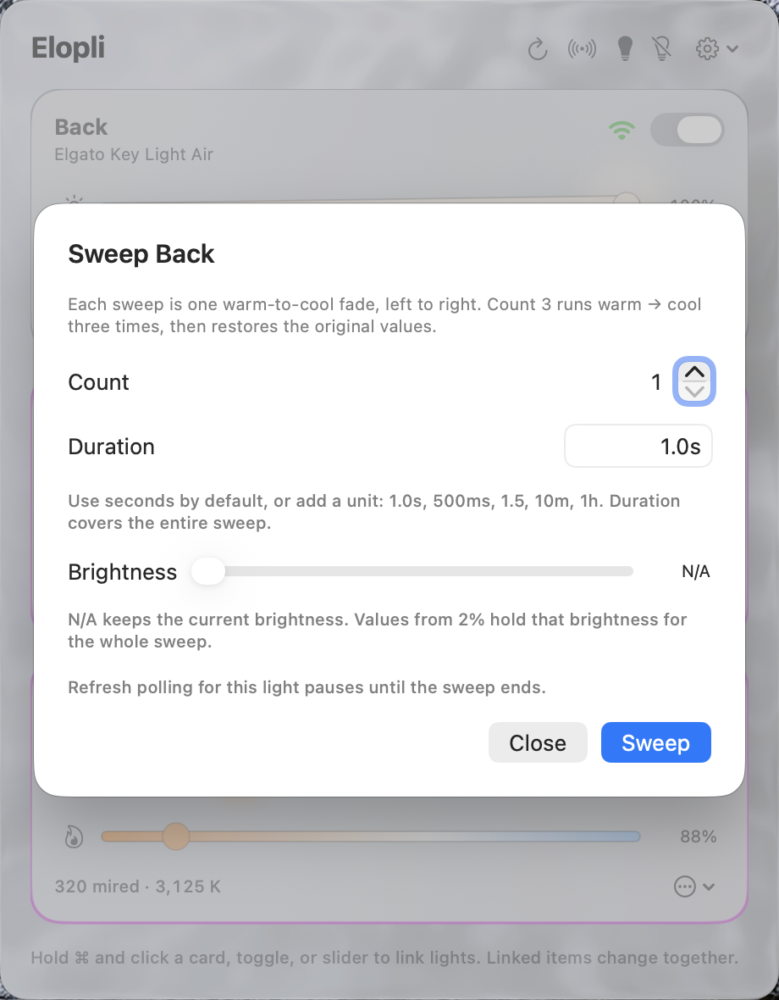
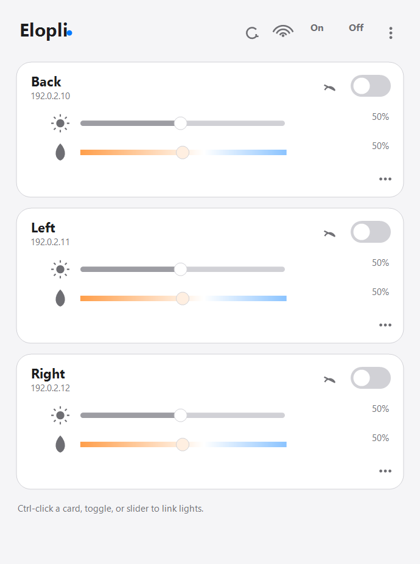
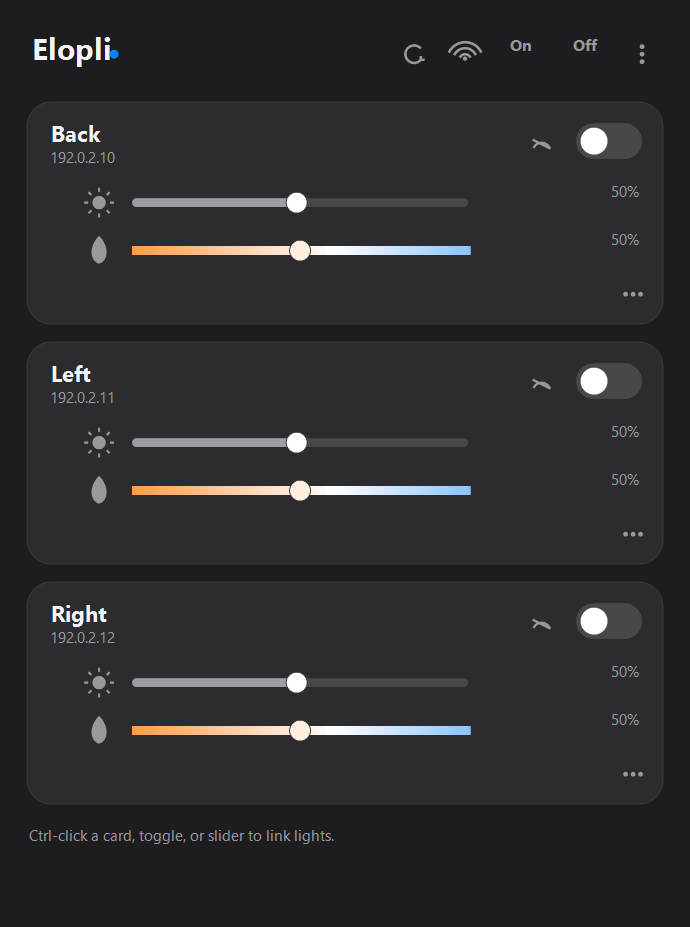
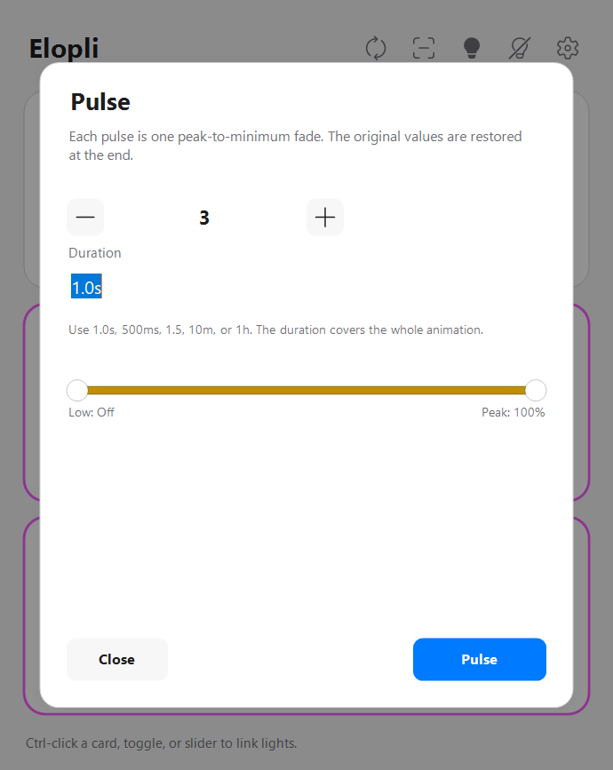

# Elopli

Elopli controls Elgato Key Light and Key Light Air devices over the local network.
It has a native macOS menu-bar app, a native Windows tray app, a Rust CLI, and a shared Rust core.

The macOS and Windows interfaces show a card for each light.
Each card has power, brightness, warmth, WiFi details, rename, and power-on behaviour.
The macOS app has no Dock icon and no draggable window.
The Windows app has no taskbar button.
Both appear as a menu-bar or notification-area panel.

Evergreen design decisions are in [DESIGN.md](DESIGN.md).

## Status

macOS and Windows are implemented.
Fedora is planned with a native UI on the same Rust core.
Accessibility and localization are planned after v1.

Verified on:

- Key Light Air, firmware 1.0.3 (222)
- Key Light, firmware 1.0.3 (222)

MAC addresses are discarded by the client. Serial numbers are retained in memory only for an on-demand tooltip and are never stored or logged.

## Screenshots

The menu panel shows a card for each light.
The magenta borders show linked lights; here Left and Right are linked.

<p>
  
</p>

Each light's menu opens the pulse and sweep editors.

<p>
  
</p>

<p>
  
</p>

The Windows app is a native tray panel with the same card layout, sheets, and link colours.

<p>
  
</p>

<p>
  
</p>

<p>
  
</p>

## Features

- Power on and off.
- Brightness from 2 to 100. The light switches off below 2.
- Warmth from 0 (cool) to 100 (warm), plus Kelvin and mired.
  The temperature slider runs warm on the left to cool/blue on the right, matching the sweep direction.
- Rename the light.
- Power-on behaviour: restore the last setting, or restore defaults.
- WiFi icon with SSID, frequency, RSSI, quality, and address on hover.
- mDNS discovery with Added, Missing, and address Update states.
- Native Apple Shortcuts actions with a multi-select light picker and per-action icons.
- Native Windows tray app with a dark and light theme, single instance, and Launch at Login.
- Link lights or individual controls with Command-click on macOS or Ctrl-click on Windows.
- Pulse brightness from the current value to a peak, then through peak-to-minimum cycles, then back to the original values.
  A count of 3 means three peak-to-minimum fades.
  The low defaults to 0% (off).
  Set the low to 2% or higher to keep the light on during each pulse.
  An off light starts and ends off: count 1 runs off → peak → off.
  The duration is split by distance across the initial rise, each fade, and the final restore.
  The app sends its own immediate keyframes at up to 10 Hz, or one per percent when the duration allows, so the duration stays exact.
  A new action stops a running pulse, and a pulse stops itself when the light changes elsewhere.
  The client uses one persistent connection and never sends animation frames over `curl`.
  Durations accept seconds by default, or an explicit unit: `1.0s`, `500ms`, `1.5`, `10m`, or `1h`.
  Both editors default to `1.0s`.
- Sweep temperature from the current value to warmest, then through warm-to-cool cycles, then back to the original values.
  A sweep can hold a fixed brightness for the whole animation.
  An off light ramps up to its stored brightness first, then sweeps, then turns off.
- Pulse and sweep editors in each light's menu.
  Refresh polling pauses for the light that is animating.
- Drag anywhere on a card to reorder. Dropping on another card swaps their positions.
- Live refresh while the menu panel is open and on activation.
- Native app icon.
- JSON output from the CLI.
- Retry and wake handling for a light that drops off the network.

## Pulse reliability

The Key Light and Key Light Air run firmware 1.0.3 (222), the final release for both.
Build 220 fixed a bug where Key Light Air became unresponsive after an undetermined amount of time; build 222 added security fixes.
There is no later firmware, and no older release is more reliable.
See the [Key Light Air firmware history](https://help.elgato.com/hc/en-us/articles/30938140888973-Elgato-Key-Light-Air-Firmware-Release-History).

There is no open firmware for Key Light Air.
[Key Right](https://github.com/micthiesen/key-right) replaces the controller in the full-size Key Light with an ESP32-C3, but that is a hardware modification, not a patch for the Air.
The MK.2 generation uses a WebSocket protocol and is more robust, but it is different hardware.

The small HTTP server is sensitive to bursts of short-lived connections.
Clients that keep one connection open do better than clients that open a connection per request.
Elopli therefore:

- keeps a native HTTP connection open and refuses to animate when only `curl` is available;
- sends native keyframes at up to 10 Hz, or one per percent when the duration allows;
- pauses refresh polling for the light that is pulsing.

Practical steps:

- Quit Elgato Control Center while using Elopli. It polls and writes the same lights.
- Prefer a native or terminal run that has Local Network permission.
- Give each light a DHCP reservation, and use a dedicated 2.4 GHz SSID if the router steers bands aggressively.
- Power-cycle a light if port 9123 stops accepting connections after a burst.

Prior art that informed this:

- [ioBroker's adapter](https://www.npmjs.com/package/iobroker.elgato-key-light) debounces writes by 200 ms.
- [python-elgato](https://github.com/frenck/python-elgato) shares one HTTP session.
- [Harness Automation](https://docs.harnessautomation.com/gem/admin/drivers/elgato_key_light) documents the occasional HTTP server lockup.

## Requirements

macOS app:

- macOS 14 or later
- Xcode 27.2 or later
- Rust 1.100
- `xcodegen` 2.48 or later (`brew install xcodegen`)

Windows app:

- Windows 10 1809 or later, x64
- Rust 1.100
- Visual Studio Build Tools 2022 with the Desktop development with C++ workload for an MSVC build
- A MinGW-w64 GCC toolchain on `PATH` instead, for a local GNU build

CLI:

- Rust 1.100

## Build the macOS app

```sh
DEVELOPMENT_TEAM=XXXXXXXXXX ./scripts/build-macos.sh
open apps/macos/Elopli/build/Build/Products/Debug/Elopli.app
```

For a release build:

```sh
DEVELOPMENT_TEAM=XXXXXXXXXX ./scripts/build-macos.sh release
```

Use `DEVELOPMENT_TEAM` to sign with your Apple Development team.
That is required for native App Intents.
Without it, the build is ad-hoc and App Intents do not register.

The script builds the Rust FFI library, generates the UniFFI Swift bindings, generates the Xcode project, and builds the app.
Debug builds set `ENABLE_DEBUG_DYLIB = NO` so Shortcuts can load the App Intents from the main executable; an `Elopli.debug.dylib` stub hides them from Shortcuts.
The app has no Dock icon.
Click the lightbulb in the menu bar.

Hold Command and click a card, toggle, or slider to link lights.
Linked items change together.
A card link is shorthand for linking all three fields on that card.
Command-clicking a field on an unlinked card joins that field to the matching group without linking its power or other fields.
Pending selections use the yellow highlight; committed links use magenta.
Drag anywhere on a card to reorder it.
Dropping a card on another card swaps their positions.
The menu panel refreshes every five seconds and immediately when the app becomes active.

## Install for Shortcuts

Native App Intents require a team-signed app.
An ad-hoc build is rejected by the system `linkd` service because it has no team ID.
Use a free Apple ID Personal Team or your Apple Development team in Xcode.
The paid Apple Developer Program is not required for local App Intents.

```sh
DEVELOPMENT_TEAM=XXXXXXXXXX ./scripts/build-macos.sh
cp -R apps/macos/Elopli/build/Build/Products/Debug/Elopli.app ~/Applications/
open ~/Applications/Elopli.app
```

The team-signed build registers the App Intents with Shortcuts.
A team ID is shown in Xcode under Settings > Accounts.
Without a team-signed build, use the CLI through **Run Shell Script** in Shortcuts.

## Build the Windows app

```powershell
cargo build --locked -p elopli-app --features windows --release
.\target\release\ElopliApp.exe
```

Build a portable ZIP, checksums, and a Scoop manifest:

```powershell
pwsh -NoProfile -File scripts\build-windows.ps1
```

The app adds a lightbulb to the notification area.
Left-click it to open the panel, and right-click it for Refresh, All On, All Off, Discover Lights, Launch at Login, Reveal Config, and Quit.
Hold Ctrl and click a card, toggle, or slider to link lights; pending selections use yellow and committed links use magenta.
Drag a card onto another card to swap their positions.
Press Esc to close a sheet or hide the panel.

See [docs/windows.md](docs/windows.md) for firewall, mDNS, autostart, signing, and smoke-test notes.
Use `-Toolchain 1.100.0-x86_64-pc-windows-gnu` with the build script for a local GNU build.

## Build the CLI

```sh
cargo build --release -p elopli
./target/release/elopli --help
```

Or install it:

```sh
cargo install --path crates/elopli
```

## Configure

Create `devices.json` in the current directory, or at the platform config path:

- macOS: `~/Library/Application Support/elopli/devices.json`
- Linux: `~/.config/elopli/devices.json`
- Windows: `%APPDATA%\elopli\devices.json`

```json
{
  "devices": [
    { "name": "Back", "host": "192.0.2.10" },
    { "name": "Left", "host": "192.0.2.11" },
    { "name": "Right", "host": "192.0.2.12" }
  ]
}
```

The host can be an IPv4 address or an mDNS name.
Run `elopli discover` to find devices.
Run `elopli discover --write` to add them to the registry.
Only devices that advertise an IPv4 address are written.

The CLI prefers `./devices.json` when it exists, so development and tests can use a local registry.
The macOS app, its App Intents, and the Windows app always use the platform config path.
Run `elopli config path` to see which file the CLI will use.
The apps reload the registry every five seconds and detect conflicting writes.
Link groups are stored in `links.json` beside the registry.

Set `ELOPLI_CONFIG` or pass `--config` to use another file.
The loader accepts a UTF-8 BOM, validates names and hosts case-insensitively, writes atomically, and uses a file lock.

## CLI

```sh
elopli status
elopli on --all
elopli off Right
elopli toggle --all
elopli brightness 50 --all
elopli warmth 70 --all
elopli kelvin 4000 --all
elopli set --on --brightness 60 --warmth 40 --all
elopli identify Back
elopli rename Right "Desk Right"
elopli power-on
elopli power-on --defaults --brightness 20 --warmth 35 --all
elopli power-on --last --all
elopli pulse --count 3 --duration 1.0s --value 100 --all
elopli pulse Left --count 1 --duration 300ms --value 80
elopli sweep --count 1 --duration 1.0s --all
elopli sweep Left --count 2 --duration 4s --brightness 40
elopli info
elopli discover
elopli config path
elopli config show
```

Durations accept a bare number as seconds, or a unit: `s`, `ms`, `m`, or `h`.
The pulse and sweep default is `1.0s`; the maximum is one hour.

Add `--json` for machine-readable output.
JSON mode emits an error object on validation or config failures and keeps the documented exit codes:
`0` success, `1` runtime/partial failure, `2` usage/config error.
Records include `error_kind` so consumers can distinguish a local error from an offline light.

### Wake a sleeping light

A light that stays off can drop off the network.
Use `--wait` to probe until the light answers; the write itself happens once, so a timed-out write is never repeated:

```sh
elopli on --all --wait 180
```

## How it works

The light serves plain HTTP on port 9123.
It announces the `_elg._tcp` service through mDNS.
A write sends a partial JSON object and returns the new state.

Read [docs/api.md](docs/api.md) for the protocol notes.
Read [docs/shortcuts.md](docs/shortcuts.md) for the Shortcuts actions.
Read [docs/platforms.md](docs/platforms.md) for the Windows/Linux plan.
Read [CHANGELOG.md](CHANGELOG.md) for release history and [THIRD-PARTY-NOTICES.md](THIRD-PARTY-NOTICES.md) for dependency licenses.

## Security

The API has no authentication and no transport encryption.
Use it only on a trusted local network.
A request that carries an `Origin` header gets HTTP 403.

Read [SECURITY.md](SECURITY.md) for the security policy and [PRIVACY.md](PRIVACY.md) for the data inventory.
The client has no cloud service, account system, or telemetry.

## Prior art

- [schlarpc/elgato-key-light-mini-firmware-re](https://github.com/schlarpc/elgato-key-light-mini-firmware-re)
- [frenck/python-elgato](https://github.com/frenck/python-elgato)
- [adamesch/elgato-key-light-api](https://github.com/adamesch/elgato-key-light-api)
- [p-conrad/klc](https://github.com/p-conrad/klc)

## Development

```sh
cargo test --workspace --locked
cargo fmt --all -- --check
cargo clippy --workspace --all-targets --locked -- -D warnings
cargo deny check
./scripts/build-macos.sh
```

On Windows, also build and lint the app with its feature enabled:

```powershell
cargo build --locked -p elopli-app --features windows --release
cargo clippy -p elopli-app --features windows --all-targets --locked -- -D warnings
```

The macOS app is in `apps/macos/Elopli`.
The Windows app is in `apps/windows/Elopli`.
The shared core is in `crates/elopli-core`.
The shared session layer is in `crates/elopli-session`.
The UniFFI bridge is in `crates/elopli-ffi`.
The CLI is in `crates/elopli`.

<!-- LICENSE/ -->

## License

Unless stated otherwise all works are:

- Copyright &copy; [Benjamin Lupton](https://balupton.com)

and licensed under:

- [Reciprocal Public License 1.5](http://spdx.org/licenses/RPL-1.5.html)

<!-- /LICENSE -->
